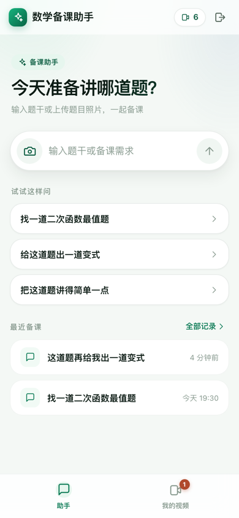
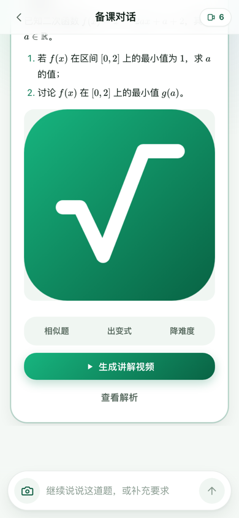
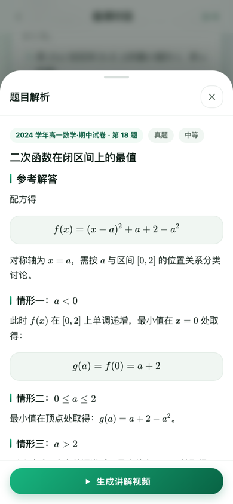
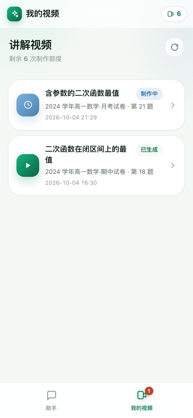

# 数学备课助手 · Web PWA

原生微信小程序 `math-tutor-miniapp` 的 Web 版。面向数学老师的移动端 PWA：找真题、出变式、降难度、看解析、生成讲解视频。功能与交互对齐小程序，界面重新设计为更精致的现代风格，支持安装到桌面与离线壳。

| 首页 | 对话 | 题目解析 | 我的视频 |
| --- | --- | --- | --- |
|  |  |  |  |

```bash
npm install
npm run dev                 # http://127.0.0.1:5173（/v1 代理到本地后端 8787）
```

## 与小程序的对齐关系

| 小程序 | Web | 说明 |
| --- | --- | --- |
| `pages/home` 首页 | `/` | 同一句引导语、同一组示例问题，增加「最近备课」 |
| `pages/chat` 对话 | `/chat`、`/chat/:id` | 流式回复、用户气泡、题卡横向轮播、解析底部抽屉、视频确认弹窗 |
| `pages/videos` 我的视频 | `/videos` | 状态色块、额度展示、5 秒轮询（页面可见时才轮询） |
| `pages/task` 任务详情 | `/videos/:id` | 播放、保存到相册、重新生成、待复核提示、题目正文 |
| `pages/history` 对话记录 | `/history` | 按今天/昨天/日期分组，点击进入对话 |
| `tabBar 助手 / 我的视频` | `Shell` 底部标签栏 | 详情页自动隐藏标签栏，改为返回按钮 |
| `mp-html` + KaTeX + marked | marked + KaTeX + DOMPurify | 换用 Web 生态成熟包，公式不再自己解析 |
| `wx.showModal` | `ConfirmDialog` | 「制作讲解视频？使用 1 次额度」确认流程一致 |
| `wx.showToast` | `toast()` | 轻提示 |
| `wx.getRandomValues` 生成 UUID | `crypto.randomUUID()` | 幂等键生成 |
| 手动 UTF-8 分块解码 SSE | `fetch` + `TextDecoder({stream:true})` | 浏览器原生支持，删掉约 40 行解码逻辑 |

保留的行为细节：SSE 事件协议（`text` / `status` / `text_reset` / `question` / `error` / `done`）、历史会话从 JSON-Lines 还原轮次、「题目已找到，解析和后续操作见题卡」的正文压缩、派生题的固定提示词与 `selectedQuestion` 透传、视频提交的幂等键按账号存本地、失败任务可重试。

## 目录结构

```
src/
  api/        client.ts（fetch + SSE）、errors.ts（错误码→中文）、types.ts（后端契约）
  auth/       session.ts（令牌存储、幂等键持久化）
  store/      teacherStore.ts（业务状态机，移植自小程序 services/teacher-store.js）
              AppContext.tsx（启动、登录、轮询、React 订阅）
  lib/        markdown.ts（marked+KaTeX+DOMPurify）、questionView.ts、questionAssets.ts
              media.ts（鉴权媒体→object URL 缓存）、photo.ts、time.ts、useInstallPrompt.ts
  components/ Markdown、QuestionCard、AgentMessage、ChatComposer、Sheet、ConfirmDialog、Toast、Shell、Icon
  pages/      Home、Chat、Videos、Task、History、Login
  styles/     tokens.css（浅/深色设计令牌）、base.css 及各模块样式
scripts/
  mock-api.mjs  本地假后端，前端可脱离 Cloudflare 独立联调
```

## 登录与 API

正式网页支持教师自行注册账号、密码和称呼，`POST /v1/auth/register` 注册后直接进入备课，`POST /v1/auth/password` 登录。Cookie 为 HttpOnly，浏览器不持有可读取的会话令牌；本地只保存登录状态、到期时间和账号资料。与小程序暂时使用独立账号，不提供自动找回密码。

其余会话、题目、照片、视频和额度接口沿用 `math-tutor-service`。Web 与 API 必须同源；生产构建固定相对 API 路径。开发态通过 Vite 代理到 `VITE_DEV_PROXY_TARGET`（默认 `http://127.0.0.1:8787`）。不再使用开发登录密钥。

## 本地联调

**接真实后端：**

```bash
# 在 math-tutor-service 仓库
npm ci && npm run dev:setup && npm run dev -- --ip 0.0.0.0 --port 8787
npm run bank:import && npm run runtime
# 本仓库
npm run dev
```

**只调前端（推荐先用这个跑通界面）：**

```bash
npm run mock                # 另一个终端，监听 127.0.0.1:8788
VITE_DEV_PROXY_TARGET=http://127.0.0.1:8788 npm run dev
```

`scripts/mock-api.mjs` 按真实接口契约返回假数据，内置两个题目、一个含题卡的会话、两条视频任务，并会模拟排队→制作中→已完成的状态流转。

## PWA

- `vite-plugin-pwa` 生成 `manifest.webmanifest` 与 Service Worker，`autoUpdate` 自动接管新版本。
- 仅预缓存公共静态资源，所有私有 API 响应走网络；新 Service Worker 激活时删除旧 `tutor-media` 缓存。
- 顶栏在浏览器支持时出现「安装到桌面」按钮；已安装或用户关闭过则隐藏。
- `/v1/*` 不参与路由回退，避免接口 404 被误当成页面请求。

构建：

```bash
npm run build      # 产出 dist/，含 sw.js 与 manifest
npm run preview    # 本地预览生产产物
npm run typecheck  # 可选；构建本身只做转译不做类型检查
```

## 上线

服务仓库的生产配置使用 Cloudflare Worker Static Assets 读取本仓库的 `dist/`，同时发布网页和 API。部署到 `https://mathprep.cn`；既有小程序 API 域名继续为 `https://api.mathprep.cn`。

先在本仓库执行 `npm run typecheck && npm run build`，再由服务仓库完成 D1 备份、远程迁移和 `npm run deploy`。生产需要迁移 `0008_password_accounts.sql`；网页构建不使用 `.dev.vars` 或开发密钥。注册和 Cookie 写请求使用同源 Origin。

## 验证

```bash
npm run typecheck   # tsc --noEmit，0 错误
npm run build       # 产出 dist/，含 sw.js 与 manifest.webmanifest
```

界面走查用无头 Chrome 通过 CDP 驱动（见 `docs/screens/`），覆盖：账号密码注册/登录 → 首页 → 打开预置会话（题卡与公式）→ 解析抽屉 → 发起流式对话（打字机 + 状态文案）→ 视频列表 → 任务详情 → 对话记录 → 深色模式。视口 390×844 @2x。全程 `window.onerror`、`unhandledrejection`、控制台 error 均为空。

## 已知边界

- 网页账号与小程序账号暂时独立；未接入微信扫码登录或自动找回密码。
- 后端未实现 CORS，跨域部署需要自行加代理或改后端。
- 视频「保存到相册」在 Web 上是下载文件，不是写入系统相册。
- 数学渲染的公式错误会以红色小方块提示原文，不会中断整段解析。
